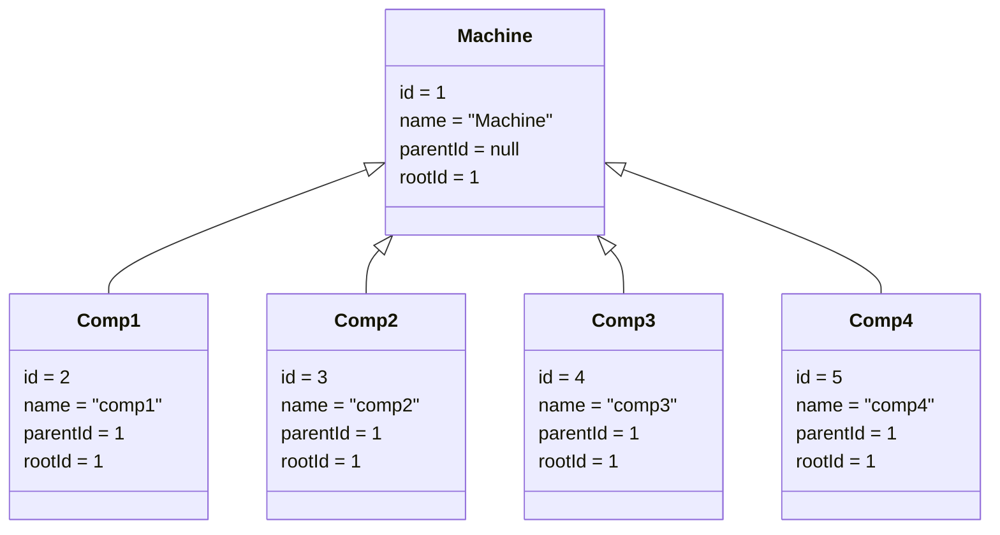
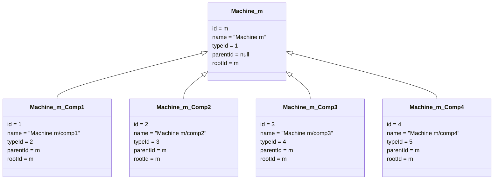

# Маппинг датасета Microsoft Azure Predictive Maintenance → ComponentDB

## Описание датасета

| Файл | Строк | Описание |
|---|---|---|
| `PdM_machines.csv` | 100 | Станки: `machineID` (1–100), `model` (model1–4), `age` (0–20 лет) |
| `PdM_failures.csv` | 761 | Отказы компонент: `datetime`, `machineID`, `failure` (comp1–4) |
| `PdM_maint.csv` | 3286 | Плановое ТО: `datetime`, `machineID`, `comp` (comp1–4) |
| `PdM_errors.csv` | 3919 | Журнал ошибок: `datetime`, `machineID`, `errorID` (error1–5) |

`PdM_telemetry.csv` в маппинг не включается: текущая модель предполагает мгновенные и
внезапные отказы (экспоненциальное распределение, постоянная λ), деградация не учитывается.

Временной диапазон: **2015-01-01 — 2016-01-01** (1 год).

---

## Структура схемы ComponentDB

Калькулятор надёжности (`ReliabilityCalculator`) работает со следующими сущностями:

- **ObjectType** — иерархия типов объектов (схема/класс)
- **Object** — структурный слот в иерархии для конкретной машины (1:1 копия дерева ObjectType на каждую машину)
- **ObjectInstance** — физический экземпляр в слоте; при замене старый «умирает», новый «рождается»
- **EventType + EventTypeMeta** — типы событий с флагами `isReplacement` и `countsAsFailure`
- **Event** — конкретное событие на экземпляре
- **ReplacementEvent** — связывает событие с заменой экземпляра (`eventId → newInstanceId`)

Ключевая формула: `λ = failureCount / operatingDays`, `MTTF = 1/λ` — считается **по каждому Object** отдельно.

---

## Правило маппинга

### 1. ObjectType (иерархия типов)

```python
ObjectType(id=1, name="Machine", parentId=null, rootId=1)
ObjectType(id=2, name="comp1",   parentId=1,    rootId=1)
ObjectType(id=3, name="comp2",   parentId=1,    rootId=1)
ObjectType(id=4, name="comp3",   parentId=1,    rootId=1)
ObjectType(id=5, name="comp4",   parentId=1,    rootId=1)
```



### 2. Object (структурные слоты, по одному дереву на каждую машину)

Object — это 1:1 структурная копия дерева ObjectType, конкретизированная под каждую машину.
Смысл: Object описывает «место comp1 в машине №5» как постоянный структурный элемент,
независимо от того, какая физическая деталь сейчас там стоит (это уже ObjectInstance).

Для каждой машины `m` (1–100):

```
Object(id=m,              name="Machine {m}",       typeId=1, parentId=null, rootId=m)
Object(id=100+4*(m-1)+1,  name="Machine {m}/comp1", typeId=2, parentId=m,    rootId=m)
Object(id=100+4*(m-1)+2,  name="Machine {m}/comp2", typeId=3, parentId=m,    rootId=m)
Object(id=100+4*(m-1)+3,  name="Machine {m}/comp3", typeId=4, parentId=m,    rootId=m)
Object(id=100+4*(m-1)+4,  name="Machine {m}/comp4", typeId=5, parentId=m,    rootId=m)
```

`rootId` каждого дерева = `id` корневого объекта-машины. Это позволяет вызывать
`ReliabilityCalculator::calculateForRootObject(data, machineId, ...)` по каждой машине.



### 3. ObjectInstance (экземпляры)

В начале периода (`2015-01-01`) создаётся по одному начальному экземпляру для каждого Object.

При каждом событии замены (отказ или ТО) для компоненты:

- старый экземпляр получает `instanceDeathTime = event.time`
- новый экземпляр получает `instanceBirthTime = event.time`

События обрабатываются в хронологическом порядке по каждой паре `(machineID, comp)`.
Если в одну дату есть и отказ, и ТО одной компоненты — отказ обрабатывается первым.

### 4. EventType и EventTypeMeta

| id | name | isReplacement | countsAsFailure | Источник |
|---|---|---|---|---|
| 1 | "Failure Replacement" | true | **true** | `PdM_failures.csv` |
| 2 | "Scheduled Maintenance" | true | false | `PdM_maint.csv` |
| 3 | "Error 1" | false | **true** | `PdM_errors.csv`, errorID=error1 |
| 4 | "Error 2" | false | **true** | `PdM_errors.csv`, errorID=error2 |
| 5 | "Error 3" | false | **true** | `PdM_errors.csv`, errorID=error3 |
| 6 | "Error 4" | false | **true** | `PdM_errors.csv`, errorID=error4 |
| 7 | "Error 5" | false | **true** | `PdM_errors.csv`, errorID=error5 |

**Примечание по ошибкам:** в датасете ошибки (`PdM_errors.csv`) не имеют поля `comp` — они
привязаны к машине в целом, а не к конкретной компоненте. Поэтому они регистрируются как
события с `countsAsFailure=true` на экземпляре самой машины (typeId=1, "Machine").
Это позволяет считать надёжность на уровне машины отдельно от надёжности компонент.

> В текущей реализации `ReliabilityCalculator` нет деления событий по уровням иерархии,
> поэтому для корректного учёта ошибок в расчёте потребуется небольшая доработка в C++.

### 5. Event и ReplacementEvent

**Из `PdM_failures.csv`:**

```
Event(typeId=1, time=datetime, instanceId=<текущий экземпляр compN машины m>, info="failure")
ReplacementEvent(eventId=..., newInstanceId=<новый экземпляр compN>)
```

**Из `PdM_maint.csv`:**

```
Event(typeId=2, time=datetime, instanceId=<текущий экземпляр compN машины m>, info="maintenance")
ReplacementEvent(eventId=..., newInstanceId=<новый экземпляр compN>)
```

**Из `PdM_errors.csv`:**

```
Event(typeId=<3–7>, time=datetime, instanceId=<текущий экземпляр Machine m>, info="errorN")
```

Ошибки не создают ReplacementEvent — машина продолжает работать.

### 6. Property (метаданные машины)

```
PropertyType(id=1, typeId=1, isStatic=true, name="model")
PropertyType(id=2, typeId=1, isStatic=true, name="age_years")
```

```
Property(propertyId=1, objectId=m, value=<model>)   -- для каждой машины m
Property(propertyId=2, objectId=m, value=<age>)
```

---

## Результат для калькулятора надёжности

После маппинга для каждой машины `m`:

```cpp
ReliabilityCalculator::calculateForRootObject(data, /*rootObjectId=*/m, analysisStart, analysisEnd)
```

Выдаёт `ComponentReliability` по каждому из 4 компонентов:

- `failureCount` — число отказов (из `PdM_failures.csv`)
- `operatingDays` — суммарное время жизни экземпляров (с учётом всех замен)
- `lambdaPerDay` = failureCount / operatingDays
- `mttfDays` = 1 / lambdaPerDay

Плановое ТО (`PdM_maint.csv`) обнуляет время жизни экземпляра (счётчик начинается заново),
но **не увеличивает** failureCount — тем самым правильно отражает накопленный ресурс.
