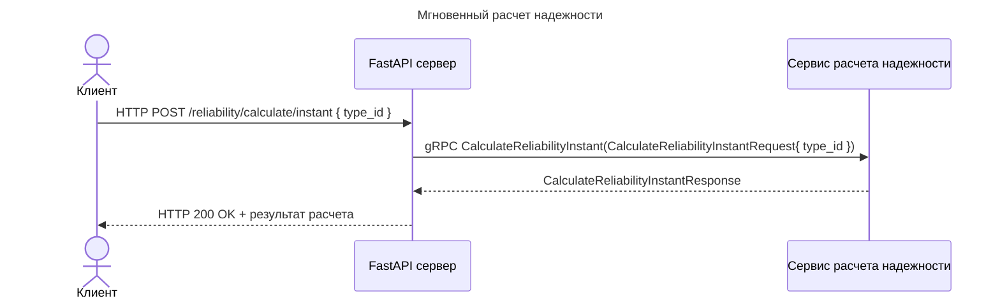
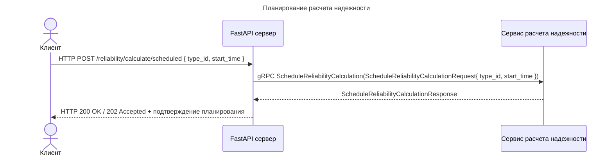
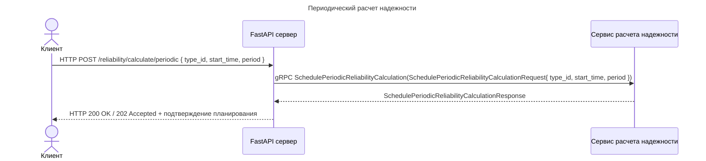
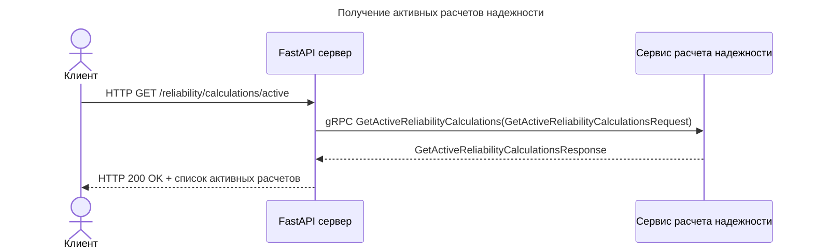
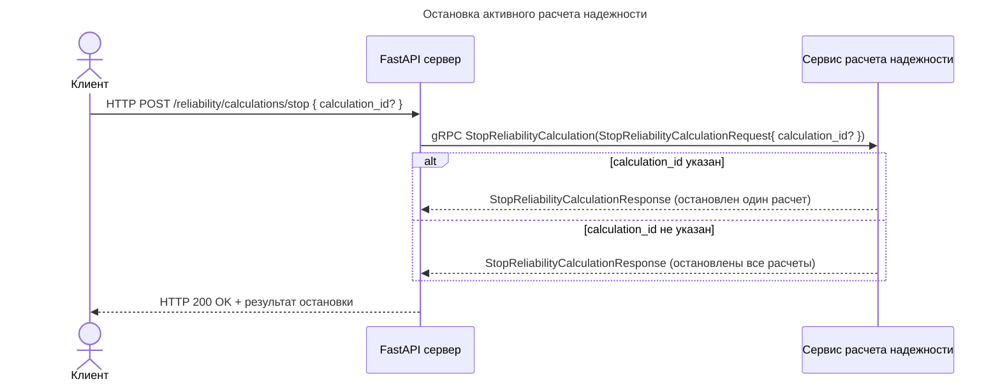
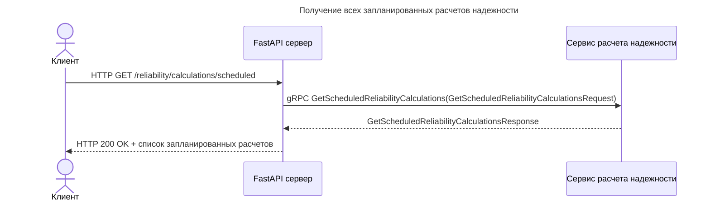
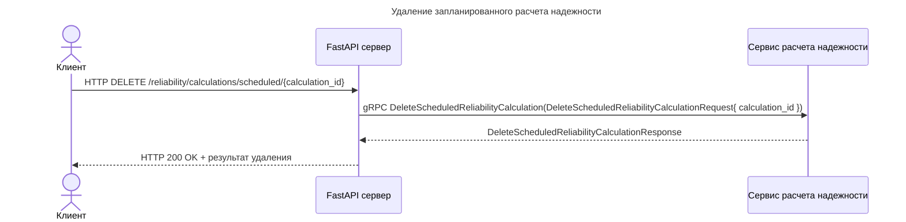
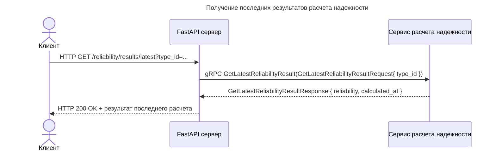

# Reliability Calculation API

## Мгновенный расчет надежности

------------------------------------------------------------------------

## Планирование расчета надежности

------------------------------------------------------------------------

## Периодический расчет надежности

------------------------------------------------------------------------

## Получение активных расчетов надежности

------------------------------------------------------------------------

## Остановка активного расчета надежности

------------------------------------------------------------------------

## Получение всех запланированных расчетов надежности

------------------------------------------------------------------------

## Удаление запланированного расчета надежности

## Получение последних результатов расчета надежности

